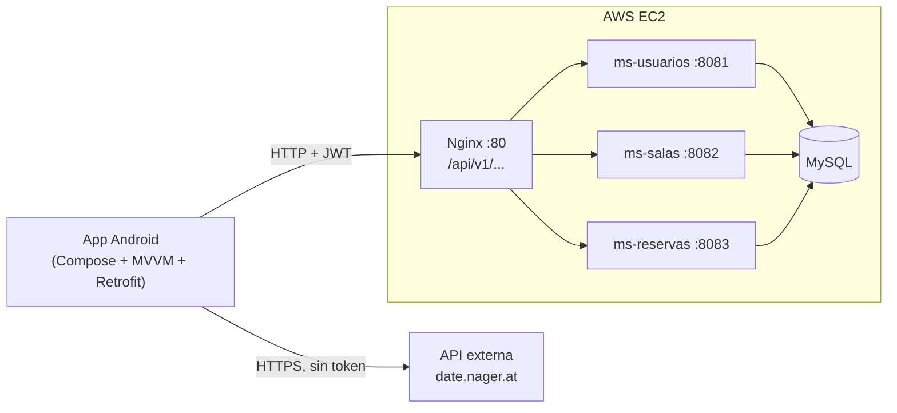
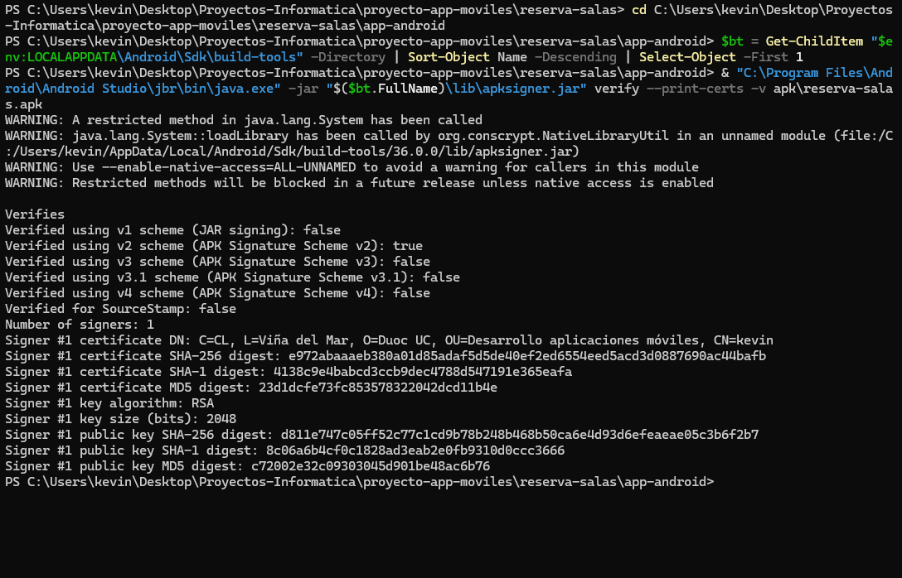
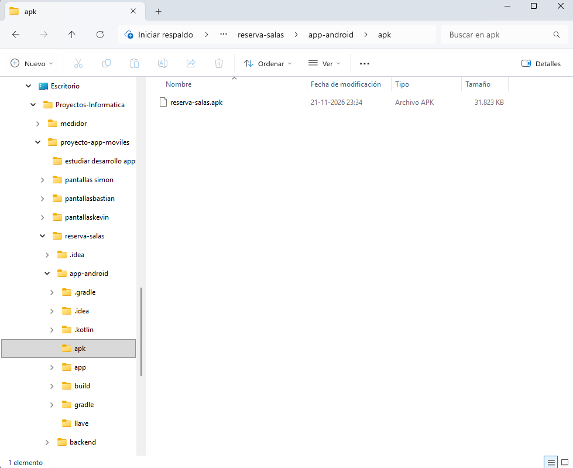
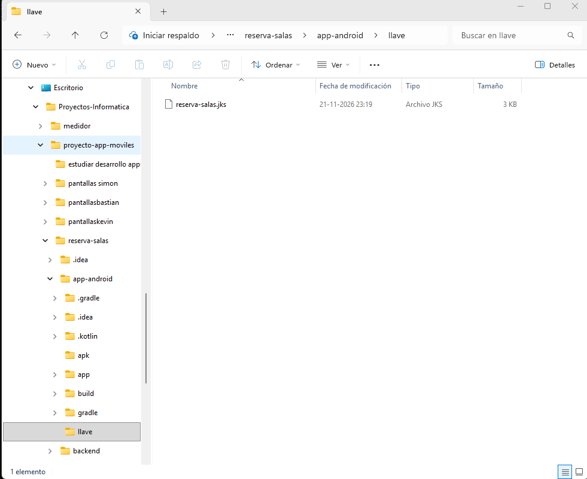

# Reserva de Salas – THERIONLABS

Proyecto semestral de **DSY1105 · Desarrollo de Aplicaciones Móviles** (Duoc UC).

App Android para reservar los espacios de **Duoc UC sede Viña del Mar** (salas, sala de
graduaciones, capilla, entre otros). Tiene un cliente real: el mandante es el propio Duoc UC.
La usan dos perfiles:

- **Relator**: busca salas, reserva por bloques de 1 hora y hace check-in escaneando el QR de la sala.
- **Coordinador**: administra salas, horarios y equipamiento, y supervisa el uso real de las reservas.

## Índice

1. [Integrantes](#1-integrantes)
2. [Funcionalidades](#2-funcionalidades)
3. [Arquitectura](#3-arquitectura)
4. [Endpoints utilizados](#4-endpoints-utilizados)
5. [Cómo ejecutar el proyecto](#5-cómo-ejecutar-el-proyecto-windows)
6. [APK firmado y llave (.jks)](#6-apk-firmado-y-llave-jks)
7. [Decisiones y limitaciones conocidas](#7-decisiones-y-limitaciones-conocidas)

---

## 1. Integrantes

| Integrante | Rol |
|------------|-----|
| Kevin Maturana     | Líder del equipo, documentación, microservicio ms-usuarios e integración app ↔ backend. |
| Bastián Veas   | Backend: microservicios ms-salas y ms-reservas. |
| Simón Stuardo     | Interfaz de la app (pantallas en Jetpack Compose). |

---

## 2. Funcionalidades

Las pantallas están en
[`app-android/app/src/main/java/cl/duoc/reservasalas/app/ui/pantallas/`](app-android/app/src/main/java/cl/duoc/reservasalas/app/ui/pantallas/).

### Ambos roles

- **Inicio de sesión real** con correo y contraseña contra el backend (token JWT). La sesión queda
  guardada: al volver a abrir la app no hay que iniciar sesión otra vez.
- **Perfil**: muestra los datos del usuario y permite editar fecha de nacimiento, teléfono y área,
  cambiar la contraseña y poner una **foto de perfil** tomada con la cámara o elegida de la galería.
- La app lleva a cada rol a su propia pantalla de inicio.

### Relator

- **Inicio**: sus reservas y aviso de feriados.
- **Buscar salas**: lista de salas con búsqueda por nombre o código y filtros de equipamiento.
- **Detalle de sala**: ubicación, capacidad, horario, equipamiento y comentarios del coordinador.
- **Reservar**: elige fecha y bloques de 1 hora libres (los ocupados y los feriados se marcan).
- **Reserva confirmada / cancelada**: resumen después de reservar o cancelar.
- **Mi agenda** y **detalle de reserva**: ver y cancelar sus reservas.
- **Check-in con QR**: escanea con la cámara el código QR de la sala para confirmar que la está usando.
- **Recordatorio 15 minutos antes** de cada reserva.

### Coordinador

- **Inicio**: resumen del día, accesos a la administración y aviso de feriados.
- **Reservas del día**: todas las reservas de una fecha.
- **Supervisar reserva**: datos del relator, botón **Llamar**, y acciones **Verificar** (fue a ver el
  uso real) o **No presentado**. La sala no se libera.
- **Editar sala**: horario propio de la sala (o usar el horario general), equipamiento, estado y
  comentarios (por ejemplo, «el proyector tiene fallas»).
- **Horario general**: apertura, cierre, pausa entre bloques y días hábiles.

### Recursos nativos del teléfono

| Recurso | Para qué se usa | Dónde |
|---------|-----------------|-------|
| Cámara + ML Kit (lector de códigos) | Escanear el QR de la sala en el check-in | `ui/pantallas/checkin/` |
| Cámara (`TakePicture`) y galería | Foto de perfil | `ui/pantallas/perfil/` |
| Alarmas exactas (`AlarmManager.setAlarmClock`) y notificaciones | Recordatorio 15 minutos antes de cada reserva | [`notificaciones/`](app-android/app/src/main/java/cl/duoc/reservasalas/app/notificaciones/) |
| Marcador de teléfono (`ACTION_DIAL`) | Botón **Llamar** al relator desde Supervisar | `ui/pantallas/supervisar/` |

### Persistencia local

- **DataStore** (en [`data/local/`](app-android/app/src/main/java/cl/duoc/reservasalas/app/data/local/)):
  - `SesionDataStore`: token y usuario de la sesión.
  - `PerfilDataStore`: datos del perfil.
  - `RecordatoriosDataStore`: qué recordatorios quedaron programados, para poder cancelarlos o reprogramarlos.
- `AlmacenFotoPerfil`: guarda la foto de perfil en el almacenamiento interno de la app.

### API externa

- **Feriados de Chile** con la API pública [Nager.Date](https://date.nager.at): se usan en Reservar y
  en las pantallas de inicio.

---

## 3. Arquitectura

**App Android** (`app-android/`)

- Kotlin + **Jetpack Compose**.
- Patrón **MVVM**: cada pantalla tiene su `ViewModel`, que pide los datos a un **Repository**.
- **Retrofit** para llamar a la API (el token se agrega solo con `TokenInterceptor`).
- Versión mínima: Android 8.0 (minSdk 26).

**Backend** (`backend/`)

- 3 microservicios **Spring Boot** (Java 21), cada uno con su base de datos **MySQL**.
- Seguridad con **JWT**: ms-usuarios entrega el token y los otros dos lo validan.
- Publicados en **AWS EC2** detrás de **Nginx**, en una sola dirección:
  `http://34.194.115.43/api/v1/`.



### Estructura del repositorio

| Carpeta | Contenido |
|---------|-----------|
| [`app-android/`](app-android/) | Proyecto de Android Studio. |
| [`backend/`](backend/) | Microservicios `ms-usuarios`, `ms-salas` y `ms-reservas`. |
| [`docs/`](docs/) | [Plan del proyecto](docs/plan-proyecto.md), [dataset](docs/dataset/), [colección de Postman](docs/postman/), [pruebas](docs/pruebas.md), bocetos, maqueta y capturas. |

---

## 4. Endpoints utilizados

Fuente: sección 5 de [`docs/plan-proyecto.md`](docs/plan-proyecto.md) (Contrato 1, versión 10).
Todas las rutas empiezan con `/api/v1`. «Público» = no exige token; «Ambos» = relator o coordinador
con token. Si otro rol intenta usar un endpoint, la respuesta es 403.

### ms-usuarios (puerto 8081)

| Método | Ruta | Rol | Para qué se usa |
|--------|------|-----|-----------------|
| POST | `/auth/login` | Público | Iniciar sesión: devuelve el token y el usuario. |
| POST | `/auth/refresh` | Ambos | Renovar el token vigente. |
| GET | `/usuarios/me` | Ambos | Ver los datos del usuario de la sesión (Perfil). |
| PUT | `/usuarios/me` | Ambos | Editar fecha de nacimiento, teléfono y área. |
| PUT | `/usuarios/me/password` | Ambos | Cambiar la contraseña. |
| GET | `/usuarios/{id}` | Coordinador | Ver los datos de contacto de un relator (Supervisar). |

### ms-salas (puerto 8082)

| Método | Ruta | Rol | Para qué se usa |
|--------|------|-----|-----------------|
| GET | `/salas` | Público | Listar salas activas (filtros: `capacidadMin`, `proyector`, `computadores`, `climatizacion`). |
| GET | `/salas?incluirInactivas=true` | Coordinador | Listar también las salas inactivas. |
| GET | `/salas/{id}` | Público | Ver una sala. |
| POST | `/salas` | Coordinador | Crear una sala. |
| PUT | `/salas/{id}` | Coordinador | Editar una sala: horario propio, equipamiento, comentarios y estado. |
| DELETE | `/salas/{id}` | Coordinador | Baja lógica: la deja en `activa: false`, no borra la fila. |

### ms-reservas (puerto 8083)

| Método | Ruta | Rol | Para qué se usa |
|--------|------|-----|-----------------|
| GET | `/bloques` | Público | Los 13 bloques de 1 hora (08:00 a 21:00). |
| GET | `/reservas?fecha=&salaId=` | Ambos | Reservas activas de una fecha (y sala). |
| GET | `/reservas/disponibilidad?fecha=&salaId=` | Público | Bloques ocupados, sin datos de quién reservó. |
| GET | `/reservas/mias` | Ambos | Reservas activas del usuario de la sesión. |
| POST | `/reservas` | Ambos | Crear una reserva (valida cruces de horario). |
| POST | `/reservas/lote` | Ambos | Crear varias reservas en una transacción (todo o nada). |
| PUT | `/reservas/{id}/cancelar` | Dueño o coordinador | Cancelar una reserva. |
| PUT | `/reservas/{id}/checkin` | Dueño de la reserva | Registrar el check-in (guarda la hora). |
| PUT | `/reservas/{id}/verificar` | Coordinador | Marcar que el coordinador verificó el uso real. |
| PUT | `/reservas/{id}/no-presentado` | Coordinador | Marcar al relator como no presentado. |
| GET | `/horario` | Público | Leer el horario general. |
| PUT | `/horario` | Coordinador | Editar el horario general. |

La colección de Postman con ejemplos está en [`docs/postman/`](docs/postman/).

### API externa: Nager.Date

| Método | URL | Token | Para qué se usa |
|--------|-----|-------|-----------------|
| GET | `https://date.nager.at/api/v3/PublicHolidays/{anio}/CL` | No necesita | Feriados de Chile del año, para marcarlos en Reservar y en Inicio. |

---

## 5. Cómo ejecutar el proyecto (Windows)

### Requisitos

- **Android Studio** (trae el SDK de Android y su propio Java).
- Un teléfono Android 8.0 o superior con la depuración USB activada, o un emulador.
- Solo para el backend local: **JDK 21** y **MySQL**.

### Opción A: app contra el servidor de AWS (por defecto)

1. Abrir la carpeta `app-android/` en Android Studio.
2. Esperar la sincronización de Gradle y presionar **Run ▶**.

O bien instalar directamente el APK firmado:

```powershell
adb install app-android\apk\reserva-salas.apk
```

### Opción B: app contra el backend local

1. En `app-android/local.properties` (no se sube a GitHub) agregar:

   ```properties
   backend.local=true
   ```

2. Con el teléfono conectado por USB, redirigir los 3 puertos del teléfono al PC:

   ```powershell
   adb reverse tcp:8081 tcp:8081
   adb reverse tcp:8082 tcp:8082
   adb reverse tcp:8083 tcp:8083
   ```

3. En cada microservicio (`backend/ms-usuarios`, `backend/ms-salas`, `backend/ms-reservas`):
   copiar `.env.example` a `.env`, completar los valores (base de datos y clave JWT) y ejecutar:

   ```powershell
   .\iniciar.ps1
   ```

4. Ejecutar la app desde Android Studio.

### Usuarios de prueba

Vienen de [`docs/dataset/usuarios.json`](docs/dataset/usuarios.json).

| Correo | Rol |
|--------|-----|
| `coordinador1@duocuc.test` | Coordinador |
| `coordinador2@duocuc.test` | Coordinador |
| `relator1@duocuc.test` | Relator |
| `relator2@duocuc.test` | Relator |
| `relator3@duocuc.test` | Relator |
| `relator4@duocuc.test` | Relator |
| `relator5@duocuc.test` | Relator |

**Contraseña:** solicitar al equipo.

### Pruebas unitarias y cobertura

Dentro de `app-android/`:

```powershell
.\gradlew.bat testDebugUnitTest
```

El detalle (JUnit, MockK, cobertura con JaCoCo sobre el 80% de la lógica) está en
[`docs/pruebas.md`](docs/pruebas.md).

---

## 6. APK firmado y llave (.jks)

| Archivo | Ubicación |
|---------|-----------|
| APK firmado | [`app-android/apk/reserva-salas.apk`](app-android/apk/reserva-salas.apk) |
| Llave (keystore) | [`app-android/llave/reserva-salas.jks`](app-android/llave/reserva-salas.jks) |

### Cómo se generó

- **Desde Android Studio:** *Build > Generate Signed App Bundle or APK > APK*, eligiendo la llave
  `app-android/llave/reserva-salas.jks` y la variante `release`.
- **Desde la terminal:** la firma está configurada en
  [`app-android/app/build.gradle.kts`](app-android/app/build.gradle.kts), en
  `signingConfigs { create("entrega") { ... } }`, y el `buildType` `release` la usa. Dentro de
  `app-android/`:

  ```powershell
  .\gradlew.bat assembleRelease
  ```

  El APK queda en `app-android/app/build/outputs/apk/release/` y se copió a `app-android/apk/`.

### Cómo verificar la firma

Con el Java que trae Android Studio y `apksigner` del SDK (cambiar `36.0.0` por la versión de
build-tools instalada):

```powershell
& "C:\Program Files\Android\Android Studio\jbr\bin\java.exe" -jar "$env:LOCALAPPDATA\Android\Sdk\build-tools\36.0.0\lib\apksigner.jar" verify --verbose --print-certs app-android\apk\reserva-salas.apk
```

### Capturas

Verificación de la firma del APK:



APK firmado:



Llave `.jks`:



> **Importante:** esta llave se creó **solo para este proyecto académico**, porque la pauta pide
> dejarla en el repositorio junto a su configuración. En un proyecto real la llave y sus
> contraseñas **nunca** irían en el repositorio: se guardarían fuera de Git (por ejemplo, en
> variables de entorno o en un gestor de secretos).

---

## 7. Decisiones y limitaciones conocidas

- **Ventana de check-in validada en el cliente.** La app solo permite el check-in desde 10 minutos
  antes hasta 15 minutos después del inicio de la reserva. En producción esta regla también se
  validaría en el servidor.
- **Servidor sin https.** El servidor de AWS usa `http`. Android bloquea `http` por defecto, por eso
  [`network_security_config.xml`](app-android/app/src/main/res/xml/network_security_config.xml) lo
  permite **solo** para la IP `34.194.115.43`; cualquier otra dirección sigue exigiendo https.
- **Recordatorios con `setAlarmClock`.** Algunos teléfonos (por ejemplo, con ColorOS) retrasan o
  descartan las alarmas normales para ahorrar batería. `setAlarmClock` es el tipo de alarma que el
  sistema respeta siempre, así el recordatorio llega a tiempo.
- **Solo dos roles (relator y coordinador)**, por decisión del mandante. La app es de uso interno
  (intranet): las cuentas las crea la institución, por eso no hay registro de usuarios ni
  recuperación de contraseña.
- **Catálogo provisional.** Las salas y su equipamiento los inventó el equipo; se reemplazarán por
  la lista real que entregue el mandante.
